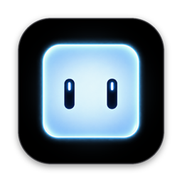
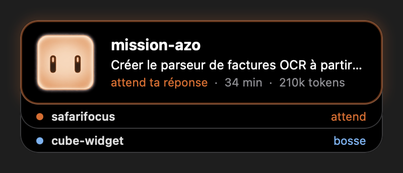
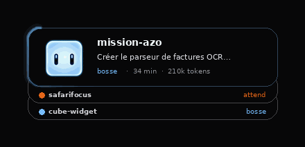
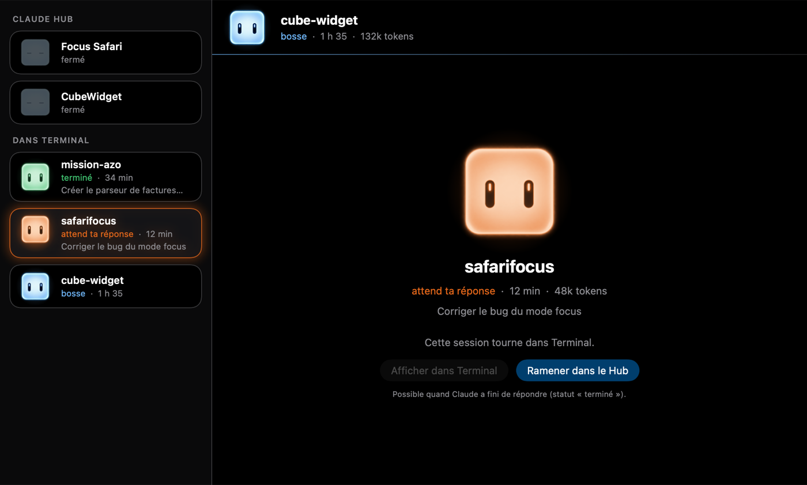

<div align="center">



# CUBE - ClaudeHub

**Tes sessions [Claude Code](https://claude.com/claude-code), d'un coup d'œil, sur ton Mac.**
Un widget de cartes et un petit cube de glace animé qui te dit quand Claude bosse, quand il t'attend, et quand il a fini.

[](https://github.com/Harlo9/CUBE-ClaudeHub/actions/workflows/ci.yml)




</div>

> [!NOTE]
> **Projet perso, non officiel.** CUBE n'est ni fait, ni soutenu par Anthropic. L'interface est en français.

---

## ✨ En bref

|   |   |
|---|---|
| 🧊 **Le cube** | Une mascotte animée qui montre l'état du projet actif : il regarde autour de lui, cligne, sautille, s'endort… |
| 🃏 **Le widget** | Le projet actif en grand (tâche en cours, statut, durée, tokens), les autres sessions empilées en dessous. Toujours au-dessus des fenêtres, sur tous les bureaux. |
| 🗂️ **Le Cube Hub** | Une fenêtre qui réunit toutes tes sessions, rangées par thèmes, avec un vrai terminal par projet. |
| 📱 **Telegram** | Facultatif : des notifications sur ton téléphone, et tu peux répondre à Claude depuis Telegram. |
| 🔔 **Barre des menus** | Un mini cube animé et la liste de toutes tes sessions. |

## 🧊 Ce que le cube te dit

| Le cube | Ce qui se passe | Autour de la carte |
|---|---|---|
| 🔵 **Bleu**, il regarde à gauche, à droite, et cligne | Claude **bosse** | un trait de lumière bleu qui fait le tour |
| 🟠 **Orange**, il sautille | Claude **attend ta réponse** : une permission, une question, un plan à valider | un halo orange fixe |
| 🟢 **Vert**, ses yeux suivent ta souris | Une tâche ou une réponse est **terminée** | un halo vert fixe |
| 😴 **Endormi**, il respire doucement | **Aucune session** ouverte | rien |

<div align="center">

</div>

Chaque changement d'état a son petit son (réglable ou coupé dans les Réglages).

## 🗂️ Le Cube Hub

<div align="center">

</div>

- Toutes tes sessions dans une liste, chacune avec son cube, son statut et sa tâche en cours.
- **Un vrai terminal par projet** ([SwiftTerm](https://github.com/migueldeicaza/SwiftTerm)) où tourne Claude Code. Changer de projet ne coupe rien.
- Des **thèmes** façon intercalaires de classeur (« Freelance », « Projet perso »…), et les cartes qu'on range en les glissant.
- Une session ouverte dans Terminal peut être **ramenée dans le Hub**, sans perdre la conversation.

## 📱 Telegram (facultatif)

- **Des notifications** quand tu n'es pas devant le Mac : tâche finie ✅, Claude attend ta réponse ⏳, réponse terminée 💬 (avec un résumé en quelques puces).
- **Répondre depuis ton téléphone** : écrire à une session, toucher **✅ Oui / ❌ Non** pour une permission, ou **choisir une réponse** à une question de Claude.
- **Tout est désactivé par défaut**, et les réponses sont protégées : code à 6 chiffres de ton app de codes (TOTP), autorisation projet par projet, limites de messages, journal de tout ce qui arrive.

---

## 🚀 Installation

**Il te faut :** macOS 14 (Sonoma) ou plus récent, les outils Swift (Xcode, ou `xcode-select --install`) et [Claude Code](https://claude.com/claude-code).

```bash
git clone https://github.com/Harlo9/CUBE-ClaudeHub.git
cd CUBE-ClaudeHub
./build.sh
```

`build.sh` compile l'app dans `build/Cube Hub.app`, installe le petit programme `cube-hook` dans `~/.cube-widget/bin/`, puis lance l'app. `./build.sh --no-run` compile seulement.

**Tests** : `swift build && swift test`. GitHub les lance aussi à chaque push, et vérifie que `build.sh` fabrique bien l'app.

### Brancher Claude Code

L'app connaît l'état de tes sessions grâce aux [hooks de Claude Code](https://code.claude.com/docs/en/hooks) : à chaque événement, Claude Code lance `cube-hook`, qui écrit un petit fichier par session dans `~/.cube-widget/sessions/`. Il n'affiche jamais rien, ne bloque jamais Claude Code (environ 13 ms par appel) et ignore ce qu'il ne comprend pas.

<details>
<summary><b>Les hooks à ajouter dans <code>~/.claude/settings.json</code></b></summary>

<br>

> [!IMPORTANT]
> Fais d'abord une copie de ton fichier, et fusionne ce bloc avec tes hooks existants si tu en as déjà.

```json
{
  "hooks": {
    "SessionStart":       [{ "hooks": [{ "type": "command", "command": "$HOME/.cube-widget/bin/cube-hook" }] }],
    "UserPromptSubmit":   [{ "hooks": [{ "type": "command", "command": "$HOME/.cube-widget/bin/cube-hook" }] }],
    "PreToolUse":         [{ "hooks": [{ "type": "command", "command": "$HOME/.cube-widget/bin/cube-hook" }] }],
    "PostToolUse":        [{ "hooks": [{ "type": "command", "command": "$HOME/.cube-widget/bin/cube-hook" }] }],
    "PostToolUseFailure": [{ "hooks": [{ "type": "command", "command": "$HOME/.cube-widget/bin/cube-hook" }] }],
    "PermissionRequest":  [{ "hooks": [{ "type": "command", "command": "$HOME/.cube-widget/bin/cube-hook" }] }],
    "Notification":       [{ "matcher": "permission_prompt|idle_prompt|elicitation_dialog",
                             "hooks": [{ "type": "command", "command": "$HOME/.cube-widget/bin/cube-hook" }] }],
    "Stop":               [{ "hooks": [{ "type": "command", "command": "$HOME/.cube-widget/bin/cube-hook" }] }],
    "StopFailure":        [{ "hooks": [{ "type": "command", "command": "$HOME/.cube-widget/bin/cube-hook" }] }],
    "TaskCreated":        [{ "hooks": [{ "type": "command", "command": "$HOME/.cube-widget/bin/cube-hook" }] }],
    "TaskCompleted":      [{ "hooks": [{ "type": "command", "command": "$HOME/.cube-widget/bin/cube-hook" }] }],
    "SessionEnd":         [{ "hooks": [{ "type": "command", "command": "$HOME/.cube-widget/bin/cube-hook" }] }]
  }
}
```

Les sessions déjà ouvertes apparaissent à leur prochain événement.

</details>

<details>
<summary><b>Les autorisations que macOS va te demander</b></summary>

<br>

- **« Cube Hub souhaite contrôler Terminal »** (bouton « Afficher dans Terminal » du Hub) : OK. Réglable dans Réglages Système → Confidentialité et sécurité → Automatisation.
- **« Cube Hub souhaite vous envoyer des notifications »** (seulement si tu allumes les commandes Telegram) : Autoriser.
- La première fois, macOS peut demander si `codesign` peut utiliser la clé du trousseau : « Toujours autoriser ». `build.sh` signe avec ton certificat « Apple Development » s'il existe, sinon avec une signature locale.

</details>

<details>
<summary><b>Les sons</b></summary>

<br>

Trois sons sont ceux de macOS (Glass, Purr, Bottle) : `build.sh` les prend directement sur ton Mac. Pour le son « Claude commence à bosser », ou pour remplacer les autres, mets tes propres fichiers dans un dossier `Sons/` à la racine : `bosse`, `fini`, `attente`, `dodo` (`.aiff`, `.wav`, `.mp3` ou `.m4a`). Un son manquant ne joue simplement rien.

</details>

<details>
<summary><b>Configurer Telegram</b></summary>

<br>

Tout se règle dans **Réglages → Telegram** (menu du mini cube dans la barre des menus) :

1. **Connexion** : crée un bot avec [@BotFather](https://t.me/BotFather) (`/newbot`) et colle son token. Il est rangé dans le trousseau macOS, jamais dans un fichier. Envoie ensuite un message à ton bot : l'app trouve ta conversation toute seule.
2. **Notifications** : allume l'interrupteur général, puis la cloche 🔔 de chaque projet. Par défaut, les messages partent seulement si tu es absent du Mac depuis 3 minutes.
3. **Commandes** (pour répondre depuis le téléphone) : configure un code de déverrouillage (un QR code à scanner dans ton app de codes), autorise les projets un par un, puis envoie `/unlock` à ton bot. `/lock` reverrouille, `/sessions` liste tes sessions, `/aide` explique le reste.

</details>

---

## 🛠️ Sous le capot

<details>
<summary><b>Organisation du code</b></summary>

<br>

```
Sources/
  CubeWidget/     l'app (SwiftUI + AppKit)
    App/          démarrage, Constants.swift (toutes les tailles, couleurs et durées)
    Widget/       les cartes et le halo
    Mascot/       le cube animé
    Hub/          la fenêtre Cube Hub et ses thèmes
    Terminal/     le lien avec l'app Terminal (AppleScript)
    MenuBar/      le mini cube de la barre des menus
    Telegram/     notifications et commandes
    Settings/     la fenêtre Réglages
    Sessions/     lecture des fichiers de session
    Sound/        les sons
  CubeHook/       le programme lancé par les hooks de Claude Code
  SessionFile/    le format des fichiers de session, partagé par les deux
Tests/            les tests automatisés (cube-hook, fichiers de session, code TOTP, ordre des cartes, textes Telegram)
.github/workflows la CI (compilation et tests sur GitHub)
Assets/           les images d'origine du cube (réduites par Scripts/make_frames.swift)
Resources/        images réduites, icône, Info.plist
docs/             les images de ce README
```

</details>

- **Tout se règle à un seul endroit** : les durées d'animation, tailles et couleurs sont dans [`Constants.swift`](Sources/CubeWidget/App/Constants.swift).
- **Léger** : ce qui tourne en boucle (le halo bleu, la respiration du cube endormi) est joué par Core Animation, sans redessiner. Le widget utilise moins de 1 % du processeur d'un MacBook Air M2.
- **Les cubes orange et vert** ne sont pas des images en plus : ils sont fabriqués dans le code à partir des images bleues.

## 📄 Licence

[MIT](LICENSE)
